# VeloGenesis

Procedural neon cycling worlds for Bluetooth smart trainers. Every ride generates a new road that keeps
forking. Push harder to take the climb, or ease off to take the easier branch. The game is built with
Godot 4.7 (.NET / C#).

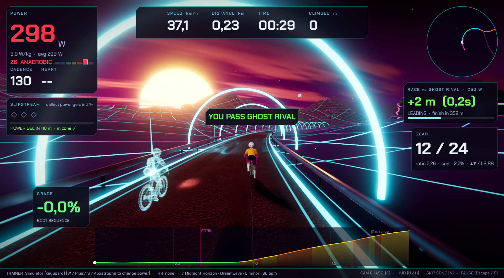

| | |
|---|---|
| 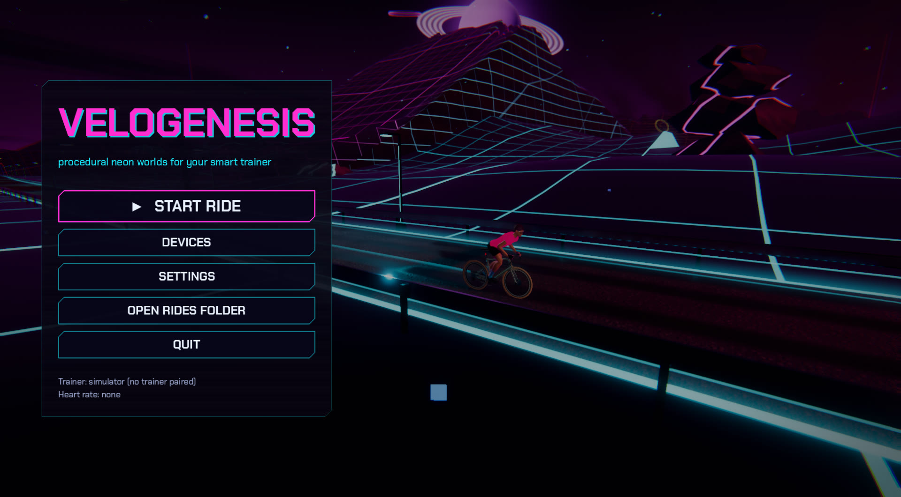 | 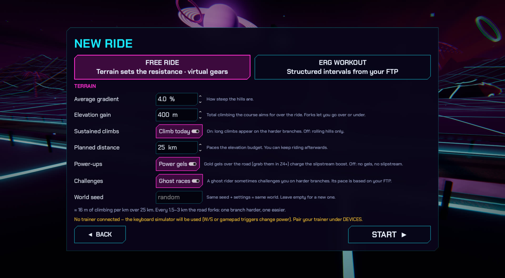 |
| 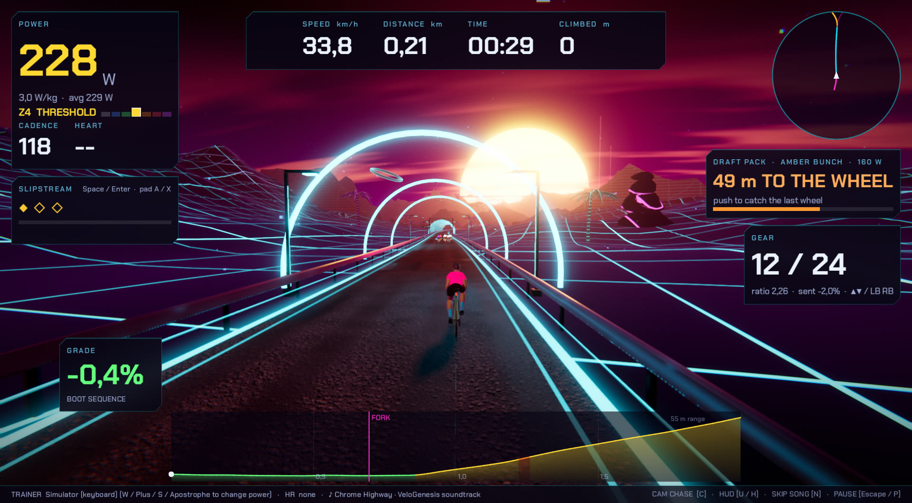 | 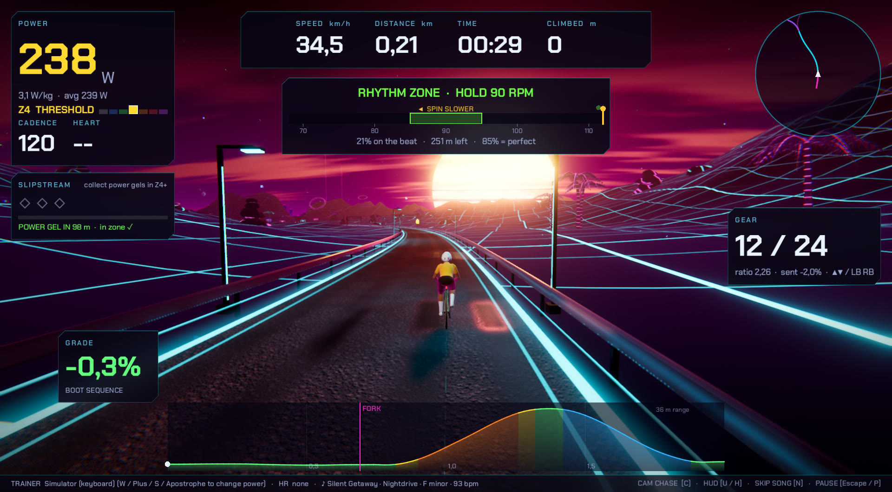 |
| 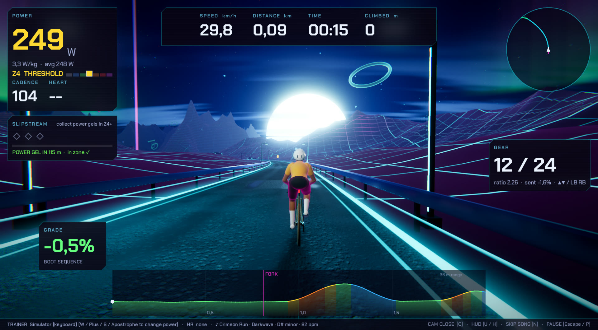 | 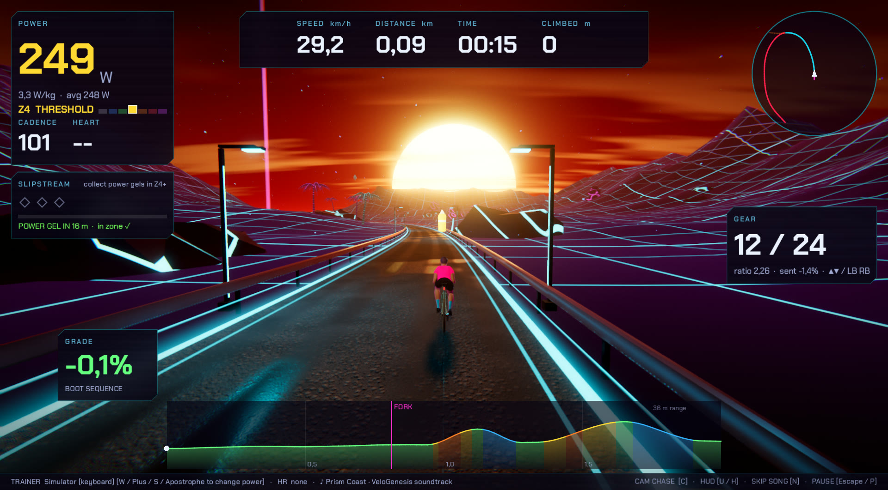 |

**ERG workouts:** pick a workout, length and FTP, then ride the intervals while the world plays on around you.

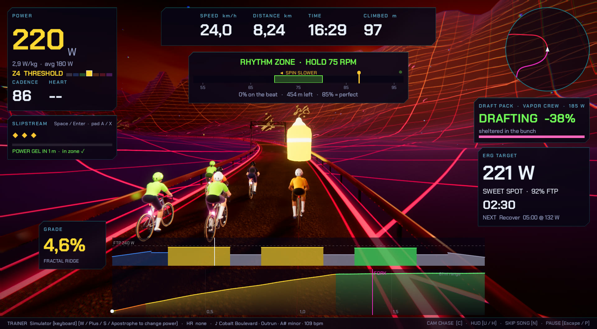

| | |
|---|---|
| 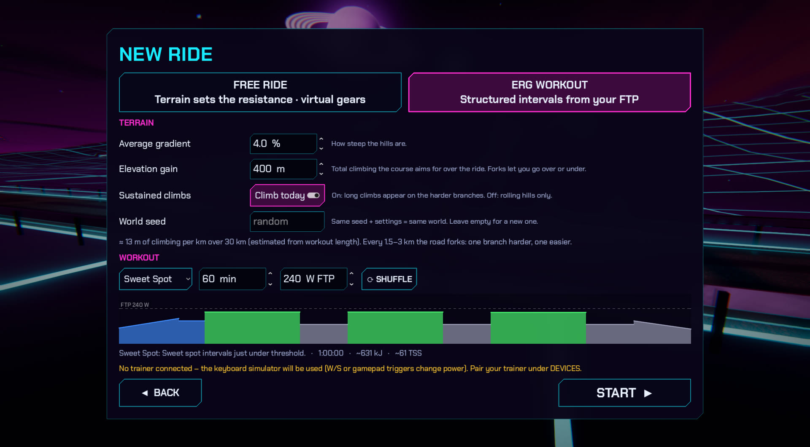 | 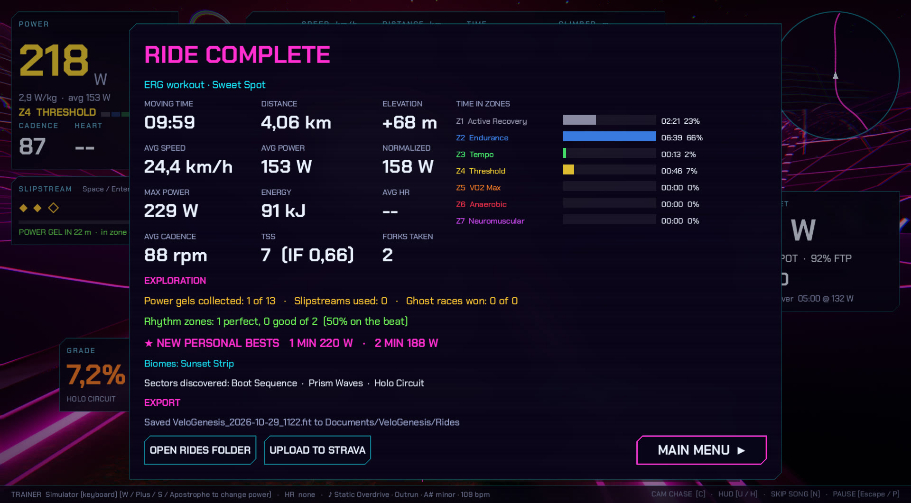 |

**Settings:** rider and bike, trainer difficulty, virtual shifting, display and quality, audio and music source,
and fully rebindable keyboard and gamepad controls.

| | |
|---|---|
| 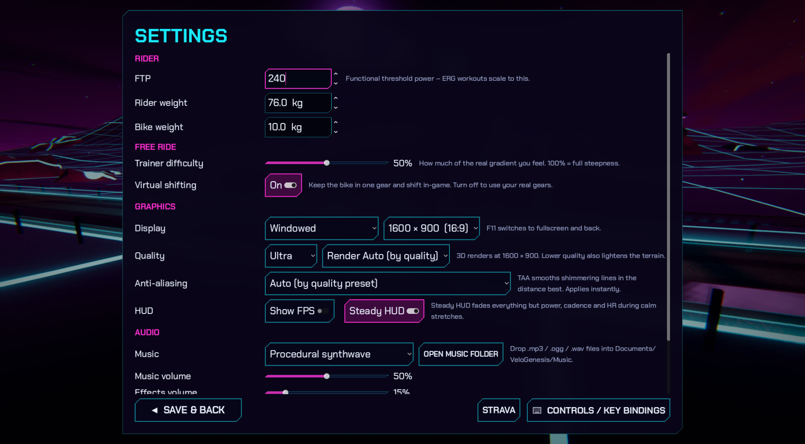 | 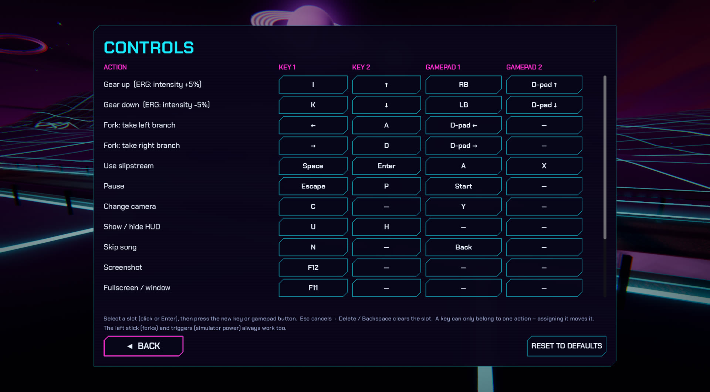 |

## Download and play

1. Download `VeloGenesis-…-windows-x64.zip` from the [latest release](https://github.com/mongo56/VeloGenesis/releases/latest).
2. Unzip it anywhere and run `VeloGenesis.exe`. You don't need to install anything: the .NET runtime is included.
3. Pair your trainer under **DEVICES**, or just press **START RIDE** and use the keyboard simulator (W / S).

Requirements: Windows 10/11 (64-bit), a GPU with Vulkan support, and Bluetooth LE for trainers and heart-rate
straps. The build isn't code-signed, so Windows SmartScreen may warn on first launch: choose
*More info → Run anyway*.

## Building from source

Requirements: Windows 10/11 with Bluetooth LE, the .NET SDK (8+; 10 is used here), and
**Godot 4.7.2 .NET** (`winget install GodotEngine.GodotEngine.Mono`).

- **Editor:** open `project.godot` in Godot .NET, then press F5.
- **Command line:** `godot --path .` (first run: `dotnet build` then `godot --path . --import`).

- **Release build:** install the Godot 4.7.2 .NET export templates, then
  `godot --headless --path . --export-release "Windows Desktop" export/VeloGenesis/VeloGenesis.exe`.

`nuget.config` pins nuget.org for this project, because the machine-wide NuGet config has no sources.

## Hardware

- **Trainer:** any Bluetooth FTMS trainer (Cycplus R200 included). Go to DEVICES → SCAN → "USE AS TRAINER".
  Close Zwift, the Cycplus app and other trainer apps first, because a trainer accepts only one controller.
- **Heart rate:** any standard BLE HR strap ("USE AS HR").
- **No hardware:** the keyboard simulator kicks in automatically. W/S or the gamepad triggers change power.

Devices are remembered and reconnect automatically on the next launch.

## Ride modes

| | Free ride | ERG workout |
|---|---|---|
| Resistance | FTMS simulation mode: grade × *trainer difficulty* | FTMS target power from the workout |
| ▲▼ / LB RB | Virtual gears (24 speeds) | Intensity bias ±5% |
| Fork choice | Power vs your 20 s baseline (±12%) | Cadence vs your 15 s baseline (±6 rpm) |

**Virtual shifting** keeps the bike in one gear. The game solves for the grade to send so that the
trainer's resistance at your cadence matches the virtual gear. It uses the trainer-reported flywheel
speed when the trainer provides it. To use your real gears instead, turn virtual shifting off in Settings.

**Terrain setup:** you set the average gradient, the total elevation gain, the planned distance and
whether to include sustained climbs. At each fork, one branch climbs more than the budget and the
other less. The branch marked **PLAN** keeps you on target.

## Power zones, gels and slipstream

The HUD shows your 7-zone power zone (Coggan: Z1 recovery … Z7 neuromuscular, from your FTP).
**Power gels** float over the road; they only light up and count when you ride through them in
**Z4 or higher**. Below that they're faint ghosts you pass straight through. Each gel gives a
slipstream charge (max 3). The ride summary shows time in each zone.

## Forks with stakes

Each branch at a fork is signposted with what it offers besides its terrain: **★ GHOST RACE**,
**≋ DRAFT PACK**, **♪ RHYTHM ZONE** or **◆ GEL RUSH** (double gels). The harder branch tends to hold
races and gels, the easier one packs. The same tags show on the fork panel in the HUD.

## Ghost races (free ride)

On a GHOST RACE branch a holographic **ghost rider** pulls up in the left lane and challenges you to a
**FINISH** arch 0.4–1.8 km ahead. It rides the same terrain with the same physics, either at a steady
85–108% of your FTP or, about half the time once you have history, as **you**. It then replays one of
your own best efforts (all-time best or your last ride) second by second. Your bests over 1–10 minutes
are saved after each ride, and the summary celebrates new ones. Beat the ghost for a slipstream charge.
Power gels and ghost races can each be switched off on the ride setup screen.

## Draft packs

On a DRAFT PACK branch you'll find a small bunch of AI riders (with glowing tail lights) cruising at
62–78% of FTP. Catch the last wheel and the air drag drops by up to 38%, both in the game's physics and
in the resistance sent to the trainer. Once you've sat in for a while they may **attack**: hold the
wheel for 25 s to earn a slipstream charge. In ERG the bunch rides at your pace. Packs follow your line
through forks but never onto a ghost-race branch.

## Rhythm zones

Arches mark a stretch with a target cadence (75–100 rpm, ±5). Hold it and the HUD meter (and your
light trail) locks green; off the beat, a metronome ticks at the target to pull you back. 85% accuracy is
a perfect run, which earns a slipstream charge. These zones are the main game in ERG, where cadence is
the one thing you control.

## Biomes

Every ~7 km the road enters a new biome: Sunset Strip, Neon Metropolis, Desert Grid or Aurora Peaks.
Each has its own sky, sun, fog, rock colours, road palettes and scenery, and the procedural music starts
a new song. A welcome arch, a banner and a sound sting mark each crossing.

## Steady HUD and audio cues

During long uneventful stretches the HUD fades everything except power, cadence and heart rate (and the
ERG panel). Any event or key press brings it back. Turn this off with **Settings → HUD → Steady HUD**.
Each kind of event has its own sound so you can follow the ride without watching the screen: fork ahead,
race start countdown, overtakes, 200 m to go, pack spotted, draft in/out, pack attack, rhythm lock and
result, new biome, and new personal best.

## Controls

All bindings can be changed in **Settings → Controls / Key bindings** (defaults below).


| Action | Keyboard | Gamepad |
|---|---|---|
| Gear up / down | I / K or ↑ ↓ | RB / LB, D-pad ↑↓ |
| Choose fork branch | ← → or A / D | D-pad ←→, left stick |
| Slipstream power-up | Space / Enter | A / X |
| Camera | C | Y |
| Screenshot | F12 | |
| Test rides only: time slower / faster (1×–8×) | F6 / F7 | |
| Toggle HUD | U / H | |
| Fullscreen / window | F11 | |
| Skip song | N | Back |
| Pause | Esc / P | Start |
| Simulator power | W / S | Triggers |

## Strava

**UPLOAD TO STRAVA** on the ride summary works without any setup. It opens Strava's web uploader and an
Explorer window with the ride's .fit file selected, and you drag the file onto the page.

**Direct upload (optional, needs a Strava subscription).** Since June 2026 Strava only lets subscribers
create API apps. If you have a subscription, you can connect the game for one-click or automatic uploads:

1. Go to **Settings → Strava → Open Strava API page** (strava.com/settings/api) and create an app.
   Any name and website work. Set **Authorization Callback Domain** to `localhost`.
2. Paste the **Client ID** and **Client Secret** into the Strava screen and click **Connect with Strava**.
   Approve access in the browser. The game listens on a random loopback port for the redirect.
3. Rides are then uploaded directly as trainer rides, named after the mode or workout, with sectors and
   races in the description. Uploading a ride a second time links to the existing activity.

Credentials and tokens are stored in `%APPDATA%/Godot/app_userdata/VeloGenesis/strava.json`.

## Files

- Rides: `Documents/VeloGenesis/Rides/*.fit` (cycling / virtual activity)
- Your music: `Documents/VeloGenesis/Music` (.mp3 / .ogg / .wav). Choose the source in Settings.
- **YouTube Music / other player:** set Settings → Music to *YouTube Music / other player*. The game's own
  music turns off. It then follows whatever is playing in the Windows media controls: YouTube Music in Firefox,
  Chrome or Edge, Spotify, and so on. The HUD shows the song, *Skip song* skips it, and pausing the ride pauses
  it. **Liked music** and **YT Music home** (where your Supermix is) open in your default browser.
  Set the volume in the browser.
- Settings: `%APPDATA%/Godot/app_userdata/VeloGenesis/settings.json`

## Code map

```
src/Main.cs                 state machine: menu (attract-mode world) → setup → ride → pause → summary
src/Core/                   settings, quality presets, input map, main-thread dispatcher
src/Devices/                WinRT BLE: scanner, FTMS trainer (ERG + sim), HR strap, keyboard simulator
src/Ride/                   ride loop, physics, virtual gearing, fork decider, workouts, recorder, FIT writer
src/World/                  course generator, mesh builder (worker thread), streaming world, shaders, avatar
src/Online/                 Strava OAuth (loopback redirect) + FIT upload
src/Audio/                  procedural synthwave engine + music director
src/UI/                     neon theme, HUD, graphs, menus
```

Debug flags (after `--`): `--autoride=free|erg`, `--screen=setup|setup-erg|devices|settings|controls|strava|pause`,
`--shot=out.png --shot-after=8`, `--skip=metres`, `--timescale=6`, `--sim-power=300`, `--seed=n`,
`--quality=Low|Medium|High|Ultra`, `--music=Procedural|Files|Both|External`, `--finish-after=sec`, `--camera=n`, `--no-ble`.

## Roadmap

- Ideas: achievements for sectors, ANT+ FE-C, an installer.

## License

[MIT](LICENSE). The Chakra Petch fonts in `assets/fonts` are under the SIL Open Font License ([OFL.txt](assets/fonts/OFL.txt)).
